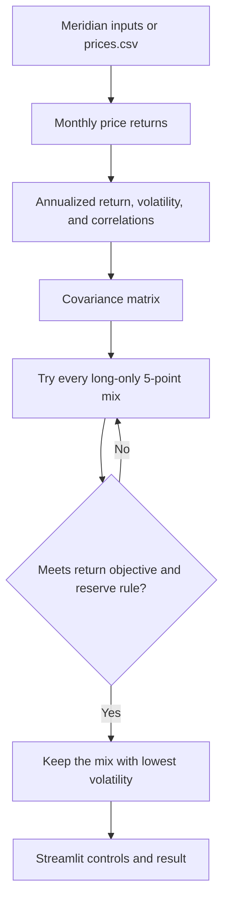

# Lab 15 — Portfolio Stability Decision

## Question

Which mix carries the least risk while meeting the mandate, and does the answer survive a one-point change in one estimate?

## App and commands

The Streamlit app is `app.py`. It imports the calculation and search functions from `portfolio.py`; it does not copy portfolio math.

```powershell
python portfolio.py
python -m streamlit run app.py
```

## Engine flowchart



## Meridian verification

| Run | Bills / 10-year / IG / equity | Return | Volatility |
|---|---|---:|---:|
| Inputs as loaded | 0 / 20 / 25 / 55 | 6.51% | 9.44% |
| Equity expected return changed 8.0% to 7.0% | 0 / 10 / 10 / 80 | 6.53% | 12.94% |

Largest weight change: **25 percentage points**. A one-point lower equity estimate moves 25 points of the allocation, so the answer is not stable.

Changing the IG bonds/equity correlation from 0.25 to 0.50 in both cells produces 0 / 40 / 0 / 60, 6.52% return, and 9.73% volatility. This proves the app uses `portfolio.py` as its engine.

## My Project 2 universe

Returns calculated from the price file are historical estimates, not forecasts.

| Ticker | Fund name | Role | Source | Download date |
|---|---|---|---|---|
| SGOV | iShares 0-3 Month Treasury Bond ETF | Cash reserve; the only reserve-eligible asset | [Yahoo Finance Historical Data](https://finance.yahoo.com/quote/SGOV/history), monthly Adj Close | 2026-10-22 |
| RXI | iShares Global Consumer Discretionary ETF | Global consumer-discretionary benchmark proxy | [Yahoo Finance Historical Data](https://finance.yahoo.com/quote/RXI/history), monthly Adj Close | 2026-10-22 |
| PEJ | Invesco Leisure and Entertainment ETF | Hospitality and leisure tilt | [Yahoo Finance Historical Data](https://finance.yahoo.com/quote/PEJ/history), monthly Adj Close | 2026-10-22 |

CSV file: `prices.csv`, 60 completed monthly observations from 2021-10-01 through 2026-09-01, oldest first.

Objective: the five-year RXI monthly-return estimate of 3.53%, plus the mandate's 1.50 percentage-point target, equals **5.03% expected annual return**. This is a historical estimate, not a forecast.

Hard constraint applied in the app: **at least 2.0% SGOV** as the cash reserve. The broader mandate also remains long-only, limits corporate issuers to 10%, and calls for at least 95% liquidity within three business days. The three selected funds are diversified ETFs; the app's explicit numeric constraint is the cash floor.

### Results after upload

| Period | Lowest-risk mix | Return | Volatility | Reserve-eligible | Largest change |
|---|---|---:|---:|---:|---:|
| All monthly observations | 55% SGOV / 0% RXI / 45% PEJ | 5.16% | 9.60% | 55.0% | — |
| Last 36 monthly returns | 95% SGOV / 0% RXI / 5% PEJ | 5.12% | 0.92% | 95.0% | 40 points |

The all-month and last-36-month runs use the same 5.03% objective and 2.0% SGOV reserve minimum. The largest allocation change is 40 percentage points: SGOV rises from 55% to 95%, while PEJ falls from 45% to 5%.

## Partner attack

My partner changed: _record the estimate they distrusted during the in-class attack._

Response: _write two sentences explaining the resulting mix and what it means after the partner attack._

## My call

**Pilot, not adopt.** Switching from five years of data to the latest 36 monthly returns moves 40 percentage points into SGOV, showing that the allocation is highly sensitive to the estimation window. I would consider adopting a mix only after the endowment committee confirms the benchmark/objective and the result remains stable across reasonable return-estimation windows.

## Estimation risk and reflection

Estimation risk is the risk that historical estimates of returns, volatility, and correlation differ from future outcomes. An optimizer amplifies small expected-return errors because it searches for a boundary solution that barely clears the target; a small change can make a different allocation the lowest-risk eligible mix.

For Meridian, lowering the equity return estimate by one percentage point changed the largest allocation by 25 points. For Project 2, changing the historical window changed the largest allocation by 40 points. I would need a well-supported return objective, validated data, and the endowment committee's answer on benchmark and tracking-error limits before adopting an optimizer's mix.
