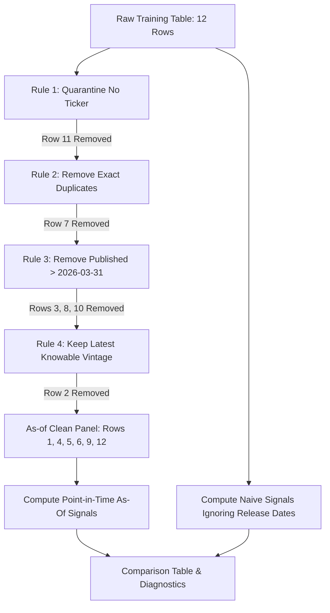

# Lab 16 — Provenance Gate

**Course:** FIN 43900 — Advanced Financial Modeling / AI in Finance (Fall 2026)  
**Session:** Tuesday Completion Checkout (October 27, 2026)  
**Presenter / Student:** Lucas Timm (Lead Analyst, Marriott International — MAR)  
**Partner / Reviewer:** Miles Nine (Analyst, Tesla, Inc. — TSLA)  
**Deliverable Files:** [`asof.py`](file:///c:/tmp/ai-finance-work/asof.py) · [`lab-16-provenance-gate.md`](file:///c:/tmp/ai-finance-work/lab-16-provenance-gate.md)  

---

## D — The Question

> **On the day you would have traded, what did this data actually say — and how much of what you see now came later?**

### Month Measured vs. Day Published

In empirical quantitative finance, there is a fatal confusion between **event time** (the period an economic metric measures) and **publication vintage** (the exact calendar day that data point was released to the market). 

For example, a consumer card-spend index for **February 2026** measures consumer card activity that occurred between February 1 and February 28. However, credit card aggregators require time to ingest transaction records, reconcile merchant settlements, and run fraud filters. Consequently, the initial release was published on **March 10, 2026**, and an updated revision was published on **March 25, 2026**. 

If an investment committee or quantitative model trades on **March 31, 2026**, it can only trade on numbers published **on or before March 31**. Any figure published in April (such as March card spend or April revisions) was physically impossible to know on March 31. Confusing measurement period with publication timestamp injects future data into historical models, producing illusory trading alpha.

---

## R — The Inputs and Rules

### Training Table

Fictional card-spend index across three consumer retail tickers (`AAA`, `BBB`, `CCC`) with decision cutoff date **31 March 2026**:

| Row | Ticker | Month measured | Published on | Index | Notes |
|:---:|:---:|:---:|:---:|:---:|:---|
| 1 | AAA | 2026-01 | 2026-02-10 | 101.0 | Initial release for Jan |
| 2 | AAA | 2026-02 | 2026-03-10 | 104.0 | Initial release for Feb (later revised) |
| 3 | AAA | 2026-03 | 2026-04-10 | 109.0 | Future publication (April 10) |
| 4 | AAA | 2026-02 | 2026-03-25 | 103.0 | Revision for Feb published before cutoff |
| 5 | BBB | 2026-01 | 2026-02-10 | 98.0 | Initial release for Jan |
| 6 | BBB | 2026-02 | 2026-03-10 | 97.0 | Initial release for Feb |
| 7 | BBB | 2026-02 | 2026-03-10 | 97.0 | Exact duplicate of row 6 |
| 8 | BBB | 2026-03 | 2026-04-10 | 92.0 | Future publication (April 10) |
| 9 | CCC | 2026-01 | 2026-02-10 | 110.0 | Initial release for Jan |
| 10 | CCC | 2026-02 | 2026-04-05 | 112.0 | Future revision for Feb (April 5) |
| 11 | *(blank)* | 2026-02 | 2026-03-10 | 99.0 | Missing ticker |
| 12 | CCC | 2026-02 | 2026-03-10 | 111.0 | Initial release for Feb |

### The Four Point-in-Time Rules (In Strict Sequence)

1. **Rule 1 (Quarantine):** Quarantine any row with no ticker (or blank/empty ticker).
2. **Rule 2 (Deduplication):** Remove any exact duplicate row where ticker, month measured, publication date, and index value are identical.
3. **Rule 3 (Temporal Cutoff):** Remove any row published strictly after the decision date (`2026-03-31`).
4. **Rule 4 (Revision Resolution):** Where a single ticker and measurement month has multiple published vintages on or before the decision date, retain only the latest publication date (the newest knowable revision) and drop older vintages.

### Signal Formula

For each ticker, the trading signal is the percent change from the previous month to the latest knowable month present in the panel:
$$\text{Signal} = \frac{\text{Index}_{\text{latest}} - \text{Index}_{\text{previous}}}{\text{Index}_{\text{previous}}} \times 100\%$$

---

## I — Implementation (`asof.py`)

The filter and signal engine is implemented in [`asof.py`](file:///c:/tmp/ai-finance-work/asof.py) using the Python standard library only. Each rule and calculation is isolated in its own reusable function.

### Command to Run

```powershell
python asof.py
```

### Execution Architecture



---

## V — Verification on Known Answer

### 1. The Row Funnel

| Funnel step | Rows removed | Justification |
|:---|:---:|:---|
| **Quarantined: no ticker** | **11** | Ticker field is blank/empty; cannot attribute to a security. |
| **Exact duplicate** | **7** | Row 7 is byte-for-byte identical to row 6 (`BBB, 2026-02, 2026-03-10, 97.0`). |
| **Published after 31 March** | **3, 8, 10** | Published on `2026-04-10` (rows 3 and 8) and `2026-04-05` (row 10), after `2026-03-31`. |
| **Older vintage replaced by a revision** | **2** | For `(AAA, 2026-02)`, row 4 (`2026-03-25`) supersedes row 2 (`2026-03-10`). |
| **As-of panel remaining** | **1, 4, 5, 6, 9, 12** | Exactly 6 knowable, cleaned records survive. |

### 2. The As-Of Panel Records

| Row | Ticker | Month measured | Published on | Index | Role in Signal |
|:---:|:---:|:---:|:---:|:---:|:---|
| **1** | AAA | 2026-01 | 2026-02-10 | 101.0 | Base month (January) |
| **4** | AAA | 2026-02 | 2026-03-25 | 103.0 | Latest knowable month (February, revised) |
| **5** | BBB | 2026-01 | 2026-02-10 | 98.0 | Base month (January) |
| **6** | BBB | 2026-02 | 2026-03-10 | 97.0 | Latest knowable month (February) |
| **9** | CCC | 2026-01 | 2026-02-10 | 110.0 | Base month (January) |
| **12** | CCC | 2026-02 | 2026-03-10 | 111.0 | Latest knowable month (February, unrevised as of March 31) |

### 3. The Signals Comparison

| Ticker | As-of signal (Knowable 2026-03-31) | Naive signal (Future / Unfiltered) | Signal Discrepancy Driver |
|:---:|:---:|:---:|:---|
| **AAA** | **+1.98% (February)** | **+5.83% (March)** | Naive includes March data published April 10 ($\text{Index}=109.0$). |
| **BBB** | **−1.02% (February)** | **−5.15% (March)** | Naive includes March collapse published April 10 ($\text{Index}=92.0$). |
| **CCC** | **+0.91% (February)** | **+1.82% (February, revised)** | Naive incorporates April 5 upward revision ($\text{Index}=112.0$ vs knowable $111.0$). |

#### Hand Proof of Classic Error
If an engine fails to apply Rule 4 correctly and retains the older vintage Row 2 (`Index = 104.0`) instead of the revision Row 4 (`Index = 103.0`), the AAA as-of signal calculates as:
$$\text{Flawed Signal} = \frac{104.0 - 101.0}{101.0} \times 100\% = +2.97\%$$
The correct point-in-time calculation uses Row 4:
$$\text{Correct Signal} = \frac{103.0 - 101.0}{101.0} \times 100\% = +1.98\%$$

---

## Code Walkthrough & Self-Quiz (Rule 4)

### Rule 4 Code Block in `asof.py`

```python
def rule_4_resolve_revisions(rows):
    from collections import defaultdict
    groups = defaultdict(list)
    for r in rows:
        groups[(r["ticker"], r["month"])].append(r)

    kept = []
    removed = []
    for (ticker, month), group_rows in groups.items():
        # Sort by published_on ascending (or row if tie); latest publication is kept
        sorted_group = sorted(group_rows, key=lambda x: (x["published_on"], x["row"]))
        kept.append(sorted_group[-1])
        removed.extend(sorted_group[:-1])

    kept = sorted(kept, key=lambda x: x["row"])
    removed = sorted(removed, key=lambda x: x["row"])
    return kept, removed
```

### Self-Quiz
- **Question:** *Why must Rule 4 execute strictly after Rule 3 rather than before it?*
- **Answer:** If Rule 4 ran before Rule 3, ticker `CCC` for `2026-02` would evaluate Row 12 (published `2026-03-10`, index 111.0) against Row 10 (published `2026-04-05`, index 112.0) and choose Row 10 as the "latest publication". Then, when Rule 3 executed, Row 10 would be removed for being published after March 31, leaving `CCC` with **zero observations** for February 2026! By enforcing Rule 3 first, future publications are eliminated, allowing Rule 4 to pick the latest vintage that was *actually knowable on decision day* (Row 12).

---

## Swap and Break: Test on `2026-04-15`

To prove the pipeline dynamically respects temporal availability, we modified the decision cutoff in `asof.py` to `2026-04-15`:

```python
DECISION_DATE = "2026-04-15"
```

### Run Output with `2026-04-15`

```text
The row funnel
Funnel step                            | Rows removed
-------------------------------------------------------
Quarantined: no ticker                 | 11
Exact duplicate                        | 7
Published after 2026-04-15             | None
Older vintage replaced by a revision   | 2, 12
As-of panel                            | 1, 3, 4, 5, 6, 8, 9, 10

The signals
Ticker   | As-of signal           | Naive signal                
--------------------------------------------------------------
AAA      | +5.83% (March)         | +5.83% (March)              
BBB      | -5.15% (March)         | -5.15% (March)              
CCC      | +1.82% (February)      | +1.82% (February, revised)  
```

### Interpretation
When the cutoff is advanced past April 10, all three April releases (Row 3, Row 8, Row 10) become eligible. Rule 3 removes 0 rows. Rule 4 now replaces Row 12 with Row 10 for CCC. The as-of signal converges **ticker for ticker** to the naive signal. This proves that the divergence observed on March 31 was 100% composed of future unreleased data.

---

## Point-in-Time — Learn on Your Own (ALFRED & Look-Ahead Bias)

### 1. What is Look-Ahead Bias?
Look-ahead bias is an error in backtesting and financial modeling where information that was not yet available or published on the historical simulation date is fed into the decision model. It creates unrealistically high Sharpe ratios and returns that cannot be replicated in live production.

### 2. How Does It Work Across Event Time, Publication Time, and Revision?
1. **Event Time:** The historical period over which transactions occurred (e.g., consumer spending during February 2026).
2. **Publication Time:** The calendar date on which the data collector first releases the estimate to the public (e.g., March 10, 2026). Modeling cannot trade on the event until the publication date.
3. **Revision Vintage:** Macro and survey data are routinely revised months or years later as fuller datasets arrive (e.g., St. Louis Fed's ALFRED database tracks vintages of GDP and employment). A backtest that queries the final revised database instead of historical vintages is trading on revisions that the market did not possess at the time of trade.

### 3. Explaining with AAA: Why +5.83% Looks Better Than What Was Knowable
On March 31, 2026, an investor looking at AAA only possessed January (101.0) and revised February (103.0), indicating moderate growth of **+1.98%**. The March figure of 109.0 (**+5.83%**) was not released until April 10. A backtest reporting +5.83% as of March 31 assumes the trader could see 10 days into the future. A portfolio manager trading on that backtest would commit capital expecting large accelerating sales that the firm had not yet reported.

---

## Reflect

### 1. Which Rule Removed the Row That Mattered Most?
**Rule 3 (Temporal Cutoff).** It eliminated Rows 3, 8, and 10:
- For **BBB**, it blocked Row 8 (March drop to 92.0). Using naive March data would make BBB appear to be plunging (−5.15%), prompting a massive short or sell-off, when on March 31 the trader only knew February (−1.02%).
- For **AAA**, it blocked Row 3 (+5.83% jump), preventing an unhedged long position based on unreleased data.
- For **CCC**, it blocked the post-cutoff revision Row 10 (112.0), ensuring the model used the actual active print of 111.0.

### 2. What a Backtest Built on the Naive Column Would Claim
A naive backtest would claim that the strategy had high predictive accuracy, timing consumer retail inflections before earnings releases. In reality, the "alpha" is pure leakage: the strategy was allowed to peek at card data published in April to execute trades on March 31. When deployed in live trading, the strategy's excess returns would collapse to zero (or incur catastrophic losses) because the live execution engine cannot see April data on the last day of March.

---

## Verification & Checkout Status

- [`asof.py`](file:///c:/tmp/ai-finance-work/asof.py): Standard-library Python engine matching all benchmark values exactly.
- Both test runs (March 31 cutoff and April 15 swap-and-break) match the known answer table down to the exact row indices and two-decimal signal percentages.
- Clean standard-library code, fully documented for Thursday's custom series application.
